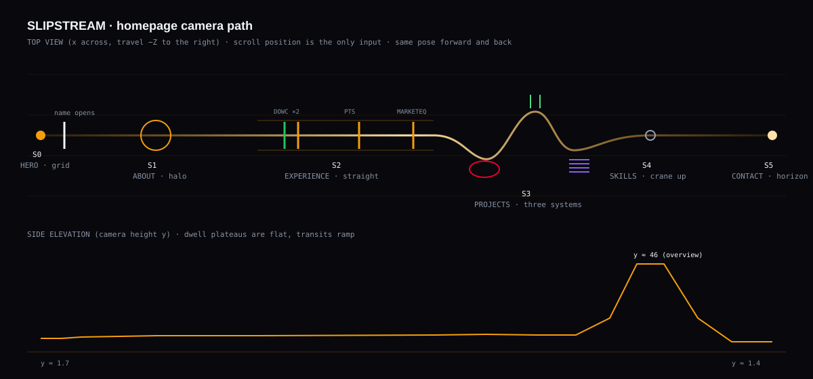

# 04 — Homepage storyboard (scene by scene)

Built on the real section order in `src/App.tsx`: `#hero` → `#about` → `#experience` → `#projects` → `#skills` → `#contact` → footer. Heights measured at 1440×900 in [00 §3](00-repository-audit.md#3-homepage-architecture-srcapptsx-1210-lines-on-originmain).

## Conventions

- **World units:** 1 unit ≈ 1 m. The grid floor is at `y = 0`. The camera eye height for dwell shots is ≈ 1.6–2.2. Forward travel is −Z.
- **Scroll mapping:** each section registers a DOM anchor. A section's **local progress** `p ∈ [0,1]` runs from "section top at viewport bottom" to "section bottom at viewport top". Each section has a **dwell plateau** (usually `p ∈ [0.18, 0.82]`) in which the camera holds the station pose with ≤0.5 unit drift. **Transits** happen in the overlap between one section's exit (`p > 0.82`) and the next one's entry (`p < 0.18`). Camera pose = `f(globalScroll)`, so it is identical whichever direction you arrive from.
- **Stations** below give the dwell pose: position → target, and vertical FOV.
- **Reading scrim:** a shader-side elliptical attenuation under the content column. Filament alpha × (1 − 0.85·mask) and grid alpha × (1 − mask). The scrim strength is a per-section uniform.
- **Reduced motion** (OS setting *or* the in-page Motion toggle): no camera travel, no velocity response. The page shows **a still frame per section**: the station pose with filaments frozen, cross-faded (opacity only, 200 ms) as section boundaries pass. All content renders immediately with no reveal transforms.
- **Mobile tier** = WebGL-lite (see [07](07-performance-accessibility-compat.md)); **static tier** = the poster image plus today's CSS speed lines.

---

## S0 — Hero, "The Grid" (`#hero`, 900 px)

| | |
|---|---|
| **Station** | cam `(0, 1.7, 9)` → target `(0, 2.0, −60)`; FOV 30° |
| **Geometry** | Infinite grid floor (68 px rhythm becomes 1.2 unit cells, fading out by z ≈ −70); filament field across 5 depth bands from z = +2 (lens-grazing) to z = −400; name plate at `(0, 2.0, −4)` (WebGL twin of the DOM `h1`); "P1 / GRID REF." as a world-space marker at `(5.2, 3.4, −10)` |
| **Scale cues** | Near filaments are thick, soft and fast; far ones are hairline and slow; the grid converges to a horizon glow; the name is 10 units wide against a ~400-unit-deep field |
| **Lighting** | Warm haze at the vanishing point (the existing 5 % radial glow becomes volumetric: a screen-space radial term plus fog tint); filaments are the only lights |
| **Entry (page load)** | t=0: DOM hero renders immediately (LCP-safe; the letter stagger becomes ≤350 ms). The canvas fades in once ready, ≤600 ms ease-out: the grid draws from the horizon outward and the first filaments ignite. Once the WebGL text is ready it cross-fades over the DOM name, pixel-aligned, and the DOM text stays as a transparent, selectable layer |
| **Content reveal** | Unchanged choreography (status pill, name, typed tagline, sub-tagline, telemetry HUD), compressed to finish by ~1.2 s |
| **Interaction** | Pointer parallax ≤0.6°; the filament wake follows the cursor; hovering the name brightens the "PAR" emissive by 10 % |
| **Transit S0→S1** ("The name opens") | As the user scrolls from 0 → ~70 % of the hero: the camera dollies forward 9 → −20. The name plate's two lines **part vertically** (PARTH +0.9, PAREKH −0.9), and the camera passes through the gap; the gate-like moment mirrors how the content opens. Filaments lengthen with velocity; FOV 30° → 42°. The DOM hero content keeps its existing fade/translate-out. The telemetry HUD slides down out of view |
| **Reverse** | Scrolling back to the top: the camera retreats through the gap, the lines close and re-align exactly with the DOM `h1` |
| **Mobile** | Vanishing point at y 0.36. ~900 filaments, no lens-grazing band (it blocks text on narrow screens). DOM name only (no WebGL twin), so the "name opens" transit becomes the existing fade plus camera dolly |
| **Reduced motion** | A still frame of the station pose; filaments frozen mid-flight (a composed, deliberate still, not a blank screen); the DOM name with no stagger |

## S1 — About, "The Halo" (`#about`, 981 px)

| | |
|---|---|
| **Station** | cam `(0, 2.0, −116)` → target `(0, 2.0, −140)`; FOV 32° |
| **Geometry** | A slow ring of filaments (radius 7, axis toward the camera) centered behind the content, opening at the bottom-left; two short arc fragments echoing the two profile panels (Technical and Academic) |
| **Depth** | The ring at z ≈ −140; the background field thinned to 40 %, so the room feels quiet and close |
| **Lighting** | The warmest scene: haze brightens slightly behind the portrait; scrim strength 0.8 over both columns |
| **Entry** | Filaments decelerate and bend into the ring over the last part of the transit. The ring "closes" as the About heading reaches the upper third |
| **Content reveal** | The existing `FadeInSection` y-28 fades are kept but shortened (0.5 s) and triggered earlier (margin −10 %). The portrait gets a 1px amber rim that the ring's light grazes (CSS, synced to a scene uniform via a CSS variable) |
| **Interaction** | Hovering the social buttons sends a small pulse around the ring (a cheap uniform impulse) |
| **Transit S1→S2** | The ring unrolls into straight parallel rails heading forward: the "straight" of Experience |
| **Reverse** | The rails roll back up into the ring |
| **Mobile** | Ring radius scaled to the viewport's short side; arcs omitted |
| **Reduced motion** | A still ring |

## S2 — Experience, "The Straight" (`#experience`, 2432 px, the longest section)

| | |
|---|---|
| **Station(s)** | A *moving dwell*: the camera travels at constant, slow speed along a straight from z −260 to −520 while the section scrolls. Position is piecewise-linear by **company article anchors**, not the section's global progress |
| **Geometry** | Two side rails of filaments (the "straight"). One **sector gate** per role, a rectangular gantry built from filaments: DOWC gets **two** gates close together (Data Engineer I, Data Analytics Intern), Perfect Threading **one**, Marketeq **one**. Gates sit at the z where each role's heading crosses the viewport's upper third |
| **Meaning** | Travelling forward moves back in time (the content is reverse-chronological). Gate count = role count, derived from `EXPERIENCE.roles.length`, so no invented data |
| **Lighting** | The current role's gate (DOWC, Data Engineer I) carries a slow green pulse matching the existing "CURRENT" marker and `#22C55E` live dot. Past gates are steady amber at 60 % |
| **Entry** | Rails ignite from the camera forward; the first gate approaches as the DOWC header arrives |
| **Content reveal** | Text is fully visible as soon as it is 6 % into the viewport (no long fades on dense, protected bullets) |
| **Interaction** | Hovering a company name brightens its gate(s) |
| **Transit S2→S3** | After the last gate (Marketeq), the rails splay outward and dissolve into three colored streams |
| **Reverse** | Gates pass in the opposite order, keyed to the same anchors |
| **Mobile** | Gates are thinner and fewer filaments per gate; the camera speed scales with the (much taller) mobile section height so gates still align with headings |
| **Reduced motion** | A still view down the straight with all gates visible in perspective |

## S3 — Projects, "Three Systems" (`#projects`, 1890 px)

Three sub-stations keyed to the article anchors `formula-vision-title`, `.is-review-bot` and `.is-aetherflow`.

| Sub-station | Station | Structure (gesture only, from real content) | Tint |
|---|---|---|---|
| **S3a Formula Vision** (flagship) | cam `(−2.5, 2.2, −640)` → `(−1.0, 1.8, −668)`; FOV 34° | A closed **racing-line ribbon** of filaments, an abstract smooth loop (not a real circuit), with **five beads** along it that light in sequence as the five architecture steps (Acquire, Canonical truth, Validate, Publish, Replay) scroll into view | `#E8002D` blended 35 % with amber |
| **S3b GitHub Review Bot** | cam `(2.5, 2.0, −720)` → `(1.0, 1.9, −745)` | Filament **packets** pass through **two** thin translucent planes (the "two-pass" review); after the second pass, packets straighten and turn green | `#4ADE80` 30 % |
| **S3c AetherFlow** | cam `(−1.5, 2.0, −790)` → `(−0.5, 1.8, −815)` | Filaments **sort into four lanes** that echo its 4-step flow (Upload, Categorize, Compute, Explore) | `#8B5CF6` 30 % |

- **Transit between sub-stations:** short lateral trucks (≤5 units) with forward dolly, never a turn > 15°.
- **Interaction:** hovering a project card or its links intensifies the tint and speeds up its structure. Focus-visible does the same, so it works with a keyboard.
- **Mobile:** the same three tints and simplified structures (ribbon with beads; two planes; four lanes), with the camera strictly centered.
- **Reduced motion:** three static tinted stills, cross-faded.

## S4 — Skills, "The Lap from Above" (`#skills`, 731 px)

| | |
|---|---|
| **Station** | Crane: cam `(0, 46, −840)` → target `(0, 0, −880)`; FOV 38°. **The one overview shot of the site** |
| **Geometry** | **Six parallel lanes** (one per `SKILLS` group S01–S06) running toward the horizon below. Far behind (+Z), the path already traveled is visible as faint structure: the halo, the gates, the three project shapes. The visitor sees the whole lap |
| **Lighting** | Coolest scene: a 5 % steel share appears in the filaments; the grid floor is most visible here (a top-down engineering plan) |
| **Entry** | A smooth crane-up during the transit (the only large vertical move), with ≤12° pitch change per 100 px of scroll, eased |
| **Interaction** | Hovering a skill card brightens its lane. Lane order matches card order |
| **Transit S4→S5** | Crane down and forward toward the horizon |
| **Reverse** | Crane back down to the AetherFlow station |
| **Mobile** | Lower crane (y 26) and lanes rotated to run vertically on screen to fit portrait |
| **Reduced motion** | A static top-down still |

## S5 — Contact, "The Horizon" (`#contact`, 942 px) and footer

| | |
|---|---|
| **Station** | cam `(0, 1.4, −990)` → target `(0, 2.6, −1400)`; FOV 30° |
| **Geometry** | All streams converge toward the vanishing point; the grid floor runs out into darkness; the warm haze grows into a soft horizon band behind "Let's build something *together*" |
| **Lighting** | The brightest haze of the site (still ≤12 % luminance), sunrise-warm; filament speed drops to 0.3·v0, so the scene is almost still |
| **Entry** | Deceleration; filaments line up toward the horizon; the CTA links appear in place (no y-translate), ready to click |
| **Interaction** | Hovering "Explore Data Solutions" bends a branch of the stream to the right, previewing the route transition. Contact links pulse the horizon |
| **Footer** | The camera settles; the motion toggle and "Back to top" remain reachable |
| **Reverse** | Streams un-converge; crane back up to Skills |
| **Mobile / reduced** | A static horizon still |

---

## Route transitions (shared canvas)

| From → to | Transition (≤700 ms, interruptible, skipped if reduced motion) |
|---|---|
| Portfolio → Data Solutions | The stream **forks right**; the camera banks ≤3° and accelerates; the content cross-fades; arrival in Data's "Confluence" hero (see [05](05-solutions-pages.md)) |
| Portfolio → Software Solutions | The stream **forks left and rises**; the camera arrives in Software's "Assembly" hero |
| Solutions ↔ Software | A lateral truck between the two worlds along the shared floor |
| Any → Portfolio | The camera retreats along the main straight to S0, and the name re-forms |
| Deep link (`/#projects`, back/forward) | No travel: the camera **cuts** to the target pose during the existing instant scroll. Long journeys are never forced |

## Anti-goals checklist (review every scene against this)

- [ ] No camera motion > 0.5 units while body text is in the central 60 % of the viewport.
- [ ] No orbit, spin, roll > 3°, zoom punch or shake.
- [ ] Filament luminance behind body text ≤ 18 % after the scrim.
- [ ] Every structure maps to real content counts; no fake numbers or labels in WebGL.
- [ ] Reverse scroll produces the same frame at the same scroll position (deterministic test).
