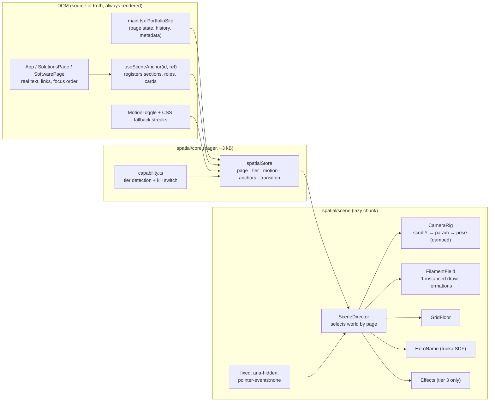

# 06 — Technical architecture

Facts and versions in this document come from the 2026-10-26 fact sheet in [01-research-dossier.md §B](01-research-dossier.md#b-technology-fact-sheet-2026-10-26). Every major choice lists its justification and the rejected alternative.

## 1. Rendering architecture: decision

| Option | Verdict | Why |
|---|---|---|
| **Fully prerendered** (Apple-style scroll-scrubbed image sequences or video) | ✗ Rejected as primary | Content heights differ per breakpoint and change with the live tenure text and `<details>` disclosures, so frame-to-scroll mapping would drift. Responsive art direction needs several sequences (MBs each). No pointer or hover response. Route transitions impossible. |
| **Fully real-time, WebGPU-first** (three `WebGPURenderer` + TSL, R3F v10) | ✗ Not yet | R3F v10 (WebGPU default) is **alpha**. `ShaderMaterial` and `EffectComposer` do not run under WebGPURenderer. Firefox and older Safari still need the WebGL2 path anyway. Revisit when R3F v10 is stable (tracked as a future milestone). |
| **Real-time WebGL2 + prerendered stills for fallbacks (hybrid)** | ✅ **Chosen** | One bespoke GLSL filament shader plus a few procedural structures. Tiny assets, so it loads fast. It responds to scroll velocity, pointer and hover. Prerendered stills (captured from the real scene by a script) serve the no-WebGL tier, the reduced-motion no-WebGL case and the OG image. |

**Stack additions (all lazy-loaded except the tiny loader):**

| Package | Pin | Justification | Rejected alternative |
|---|---|---|---|
| `three` | `0.186.x` (exact minor) | Industry standard; r186 current. Pinned because `postprocessing` peers `three <0.187` | Babylon (heavier, no React integration benefit here) |
| `@react-three/fiber` | `^9.8.2` | React 19.3-compatible, StrictMode Canvas fixes, declarative per-route scenes with automatic disposal, Suspense for font loading. Fits the existing React tree and the conditional route rendering in `main.tsx` | Vanilla three in an imperative module: leaner (~40 kB), but re-implements lifecycle, disposal and route composition by hand. Acceptable fallback if bundle budgets fail |
| `@react-three/drei` | `^10.7.9`, **deep imports only** | Only `Text` (troika SDF), `PerformanceMonitor`, `AdaptiveDpr` | Hand-rolled SDF text |
| `postprocessing` + `@react-three/postprocessing` | `6.39.x` / `3.2.x` | One mipmap Bloom + tone mapping pass, **desktop tier 3 only** | Three's `EffectComposer` (more passes, worse perf) |
| `@playwright/test` (dev) | `^1.64` | Saved as a devDependency (CI currently installs Playwright with `--no-save`); visual regression and perf sampling | Cypress |
| `@types/three` (dev) | matching | Types | n/a |

**Explicitly not added:** GSAP/ScrollTrigger (camera math is custom and the scroll position is read directly; a second animation system would duplicate Framer Motion and compete for the frame); Lenis (scroll smoothing counts as interaction-triggered motion and risks feeling hijacked; smoothing happens on the *camera*, not the scroll); `zustand` directly (a 30-line external store is enough); `detect-gpu` (runtime frame sampling is more truthful).

## 2. System overview



## 3. Module layout (proposed)

```
src/spatial/
  core/                       # eager, framework-light, tested in isolation
    store.ts                  # createSpatialStore(): subscribe/getState/setState (useSyncExternalStore)
    capability.ts             # detectTier(), kill switch (?spatial=off|lite|full, localStorage)
    anchors.ts                # anchor registry + measurement (ResizeObserver, fonts.ready)
    scrollMap.ts              # piecewise scrollY → path param with plateaus (pure, unit-tested)
    motionPreference.ts       # prefers-reduced-motion + in-page toggle → 'full' | 'still'
  dom/
    useSceneAnchor.ts         # hook for page components (adds data-scene-anchor, registers ref)
    MotionToggle.tsx          # HUD control, aria-pressed, persisted
    SpatialMount.tsx          # lazy-loads the scene chunk after idle; error boundary; fallback swap
  scene/                      # lazy chunk
    SpatialCanvas.tsx         # <Canvas> config, context-loss handling, PerformanceMonitor
    SceneDirector.tsx         # picks world + handles route transitions
    CameraRig.tsx
    worlds/
      portfolio.ts            # Station[] + formation specs (data, typed)
      solutions.ts
      software.ts
    field/
      FilamentField.tsx
      filament.vert.glsl
      filament.frag.glsl
      formations.glsl         # ring, gates, lanes, ribbon(spline texture), knots, modules
    GridFloor.tsx
    HeroName.tsx
    Effects.tsx
    debug/SpatialDebug.tsx    # ?spatial-debug: anchors, plateaus, pose, frame stats (dev only)
public/fonts/SpaceGrotesk-Bold.woff   # subset for troika (troika cannot read woff2)
public/spatial/posters/*.webp         # generated stills (static tier, OG)
```

Rules: `core/` has **no three.js import** (it stays in the initial bundle). `scene/` is only reachable through `React.lazy`. Worlds are **data** (typed station arrays), not components, so art direction tweaks don't touch rendering code.

## 4. Key types

```ts
export type Tier = 0 | 1 | 2 | 3;   // 0 static/no-JS-equivalent, 1 CSS streaks, 2 WebGL lite, 3 WebGL full
export type MotionMode = 'full' | 'still';

export interface Pose { position: [number, number, number]; target: [number, number, number]; fov: number; }

export interface Station {
  id: string;                 // 'hero' | 'about' | 'experience:role:0' | ...
  anchor: string;             // anchor id registered from the DOM
  pose: Pose;
  plateau: [number, number];  // local progress range where the camera holds (default [0.18, 0.82])
  scrim: number;              // 0..1 reading scrim strength
  density: number;            // 0..1 share of the filament budget visible
  formation: FormationSpec;   // which structure filaments lock into, and its params
  tint?: string;              // hex blended into filament color
  speed?: number;             // multiplier of base flow speed v0
}

export type FormationSpec =
  | { kind: 'free' }
  | { kind: 'ring'; radius: number; center: Vec3; gap?: number }
  | { kind: 'gates'; at: Vec3[]; size: [number, number]; pulseIndex?: number }
  | { kind: 'lanes'; count: number; spacing: number; origin: Vec3; dir: Vec3 }
  | { kind: 'ribbon'; splineTexture: 'fv-loop'; beads: number }
  | { kind: 'planes'; count: number; spacing: number }
  | { kind: 'knots'; count: number } | { kind: 'modules'; count: number; layout: 'bays' | 'plinths' | 'stack' };
```

## 5. Scroll and camera orchestration

1. **Anchors.** Page components call `useSceneAnchor('projects', ref)` (and finer anchors such as `experience:role` on each role block, `projects:fv`, `sol:service`). The hook only adds a `data-scene-anchor` attribute and registers the element; **no wrapper elements, no layout change**, matching the precedent of `useSolutionsScrollReveal`.
2. **Measurement.** `anchors.ts` stores each anchor's document-space `top`/`height`, re-measured on `ResizeObserver(document.documentElement)`, `document.fonts.ready`, `<details>` `toggle` events, and route changes. Measurements are cached; nothing is read from layout inside the frame loop.
3. **Scroll map (pure function).** `buildScrollMap(anchors, stations, viewportH)` returns sorted keyframes `{ y, s }`, where `s` is the camera path parameter; plateaus produce flat segments. `mapScroll(y) → s` uses smootherstep between keyframes. Unit-tested: monotonic, continuous, plateau-flat, deterministic.
4. **Camera rig (inside `useFrame`).** Read `window.scrollY` once per frame (no scroll listener needed), `sTarget = mapScroll(scrollY)`, then `s = damp(s, sTarget, λ=7, dt)`. Position comes from a centripetal `CatmullRomCurve3` through the station positions (plus transit control points); the target from a second curve; orientation `lookAt(target)` with optional bank = clamp(curvature·k, ±3°); FOV interpolated between stations with velocity widening. Velocity `v = (sTarget − sPrev)/dt` is low-passed and fed to the filament uniforms.
5. **Determinism.** The pose is a pure function of `s`; damping only lags. In test mode (`?spatial=test`) damping is disabled and time is frozen, so pose(scrollY) is exactly reproducible forward and back.
6. **Section reveal sync.** DOM reveals keep using Framer Motion/IntersectionObserver. Scene uniforms that should coincide with DOM events (gate lights, bead sequence) derive from the same anchor progress values, not from timers.
7. **Deep links and nav jumps.** When `scrollY` jumps more than 1.5 viewports in one frame (hash navigation, `scrollIntoView({behavior:'instant'})`), the rig **cuts** (sets `s = sTarget`) and plays a 250 ms filament streak burst. When the jump is smooth (in-page nav uses `behavior:'smooth'`), the camera follows naturally at compressed speed.

## 6. Animation ownership and lifecycle

| Concern | Owner | Notes |
|---|---|---|
| 3D frame loop | **R3F only** (single rAF) | No other code calls rAF for 3D. `frameloop="always"` in `full` mode, `"demand"` in `still` mode (render on scroll/resize via `invalidate()`) |
| DOM entrances, nav dropdowns, hero fade | Framer Motion (existing) | Unchanged library; durations tightened |
| Solutions reveals | `useSolutionsScrollReveal` (existing) | Unchanged |
| CSS streaks | CSS (existing) | Remain as tier 1 and as the pre-load layer; fade out on `html.spatial-ready` |
| Typed tagline | existing `setTimeout` hook | Add `aria-live="off"` and expose the full list to assistive tech (see 07) |
| Background tab | Browser rAF throttling + `visibilitychange` → R3F `setFrameloop('never')` | Saves battery |

Unmounting: the Canvas is mounted **once** (sibling of the page components in `PortfolioSite`) and survives route changes. Worlds swap inside it; GPU resources for world-specific structures are disposed by R3F on unmount; the filament field and floor persist across routes (no re-upload).

## 7. Content and rendering separation

- Content stays where it is (`App.tsx` data constants, `solutionsData.ts`, `deliveryExamples.ts`, `softwareProjects.ts`). **The scene never imports content modules.** Counts such as gates per role come from registered DOM anchors, so the protected `EXPERIENCE` block is never touched and the build guard keeps passing byte-for-byte.
- Sections that should show the canvas need transparent backgrounds: today `#hero`, `#about`, `#contact` set `background: var(--bg-0)` and `#experience`/`#skills` set `var(--bg-1)` inline. These become transparent *only when* `html.spatial-ready` is set; otherwise the current backgrounds remain. Cards keep semi-opaque surfaces (`--bg-card` at 88–92 % alpha with an optional 8 px backdrop blur on desktop only).

## 8. Assets

| Asset | Format | Budget | Source |
|---|---|---|---|
| Space Grotesk 700 subset (`PARTHEK`) | `.woff` | ≤ 15 kB | Self-hosted from the OFL font (license file added) |
| Noise / blue-noise | 64×64 PNG | ≤ 6 kB | Generated |
| FV ribbon spline | 256×1 RGBA float `DataTexture` built at runtime from ~24 control points | 0 kB network | Code |
| Poster stills (per section × 2 sizes) | WebP q≈70, 1600w + 800w | ≤ 60 kB each | `scripts/capture-posters.mjs` renders the real scene at tier 3 |
| OG image | 1200×630 JPEG | ≤ 120 kB | Same script |

No glTF models, so no Draco, Meshopt or KTX2 pipeline is needed. If a future structure needs a mesh: `gltf-transform optimize --compress meshopt --texture-compress ktx2` with `KTX2Loader.detectSupport(renderer)` before loading.

## 9. Loading and error states

```mermaid
sequenceDiagram
  participant B as Browser
  participant D as DOM (React)
  participant M as SpatialMount
  participant S as Scene chunk
  B->>D: HTML + main.js (no three.js)
  D->>B: Hero text painted (LCP) + CSS streaks (tier 1 look)
  D->>M: detectTier() (reduced motion, saveData, WebGL2, memory, coarse pointer)
  alt tier ≥ 2 and not killed
    M->>S: requestIdleCallback → import('./scene') (timeout 2s)
    S-->>M: Canvas ready + first frame rendered
    M->>D: html.spatial-ready (CSS streaks fade 400ms, sections go transparent)
  else tier ≤ 1
    M->>D: keep CSS streaks / static poster
  end
  Note over S: PerformanceMonitor: sustained p95 > 22ms → tier 3→2; still bad → tier 1 (sessionStorage)
  Note over S: webglcontextlost → preventDefault, show tier-1 look; restored → rebuild; 2 losses/60s → tier 1
  Note over M: ErrorBoundary catch → tier 1 for the session, console.warn once
```

## 10. Mobile strategy (summary; details in 07)

Tier 2 by default on coarse pointers: ≤1,200 filaments, DPR cap 1.5, no post-processing (glow is baked into the fragment profile), no WebGL name, simplified formations, no pointer wake. `PerformanceMonitor` can raise to 1,600 filaments or lower to 600 before dropping to tier 1. Resize handling ignores small height changes (the address bar) so the layout and camera don't jump.

## 11. Accessibility and reduced motion (summary; details in 07)

`aria-hidden="true"` canvas with `pointer-events:none`; all information in the DOM; `prefers-reduced-motion: reduce` → `still` mode; a **Motion toggle** in the HUD and nav (WCAG 2.2.2 pause for the auto-playing background); focus states drive the same scene highlights as hover; homepage skip link added.

## 12. SEO preservation

Content, headings, metadata and canonical logic are unchanged and still in the DOM. The canvas adds no text. Additions: `og:image` and `twitter:card=summary_large_image` per page (generated posters). Optional later milestone: build-time prerender of the three entries for no-JS crawlers (not required; content is already rendered client-side today).

## 13. Browser compatibility

| Browser | Tier ceiling | Notes |
|---|---|---|
| Chrome/Edge ≥ 120 desktop | 3 | Primary target |
| Safari ≥ 17 macOS | 3 | Verify bloom cost on Intel Macs; Safari caps rAF in Low Power Mode |
| Firefox ≥ 128 | 3 | WebGL2 path |
| iOS Safari ≥ 17 | 2 | Watch canvas memory limits; DPR cap; test address-bar resize |
| Chrome Android (mid-range) | 2 | Adreno/Mali fill rate is the bottleneck: instance and DPR caps |
| No WebGL2 / blocklisted GPU | 1 | CSS streaks (today's site) |
| JS disabled | 0 | Today's site minus animations (already the case) |

## 14. Testing and visual regression

- **Unit (Vitest, dev dep):** `scrollMap` (monotonic, continuous, plateau, inverse symmetry), `capability` (tier matrix), `store`.
- **Existing scripts kept green:** `check-experience-baseline`, `check-software-page`, `check-solutions-motion`, `compare-existing-routes`.
- **Playwright specs (new):**
  - `spatial.determinism.spec.ts`: in `?spatial=test&seed=1`, render at scrollY X arriving from the top and from the bottom; pixel diff ≤ 0.1 %.
  - `spatial.visual.spec.ts`: `toHaveScreenshot` per station at 1440×900 and 390×844 (Chromium, SwiftShader in CI; assert `WEBGL_debug_renderer_info` first); mask the typed tagline and tenure strings; `maxDiffPixelRatio 0.002`.
  - `spatial.contrast.spec.ts`: for each text block, sample the canvas behind its bounding box and assert WCAG contrast ≥ 4.5:1 against the brightest sample.
  - `spatial.a11y.spec.ts`: axe-core scan per route; Motion toggle keyboard operable; reduced-motion emulation produces no camera movement (pose constant while scrolling).
  - `spatial.fallback.spec.ts`: `?spatial=off`, WebGL disabled, forced context loss → content intact, CSS streaks visible, no console errors.
  - `spatial.perf.mjs` (local, real GPU, not CI): rAF frame-time sampling over a scripted scroll; reports p50/p95/p99 and long-animation-frames.

## 15. Deployment and rollback

- Build-time flag `VITE_SPATIAL=on|off` (default **off** on `main` until authorized) plus a runtime kill switch (`?spatial=off`, persisted). Rollback options: (1) flip the env var and redeploy; (2) revert the merge commit; (3) runtime switch for an individual visitor.
- Every milestone ships to a **Vercel preview** only. Production deploys from `main` happen only after explicit authorization (see [08](08-branch-and-milestones.md)).
- Bundle guard script: fail the build if the initial chunk exceeds 145 kB gzip or the scene chunk exceeds 270 kB gzip.
